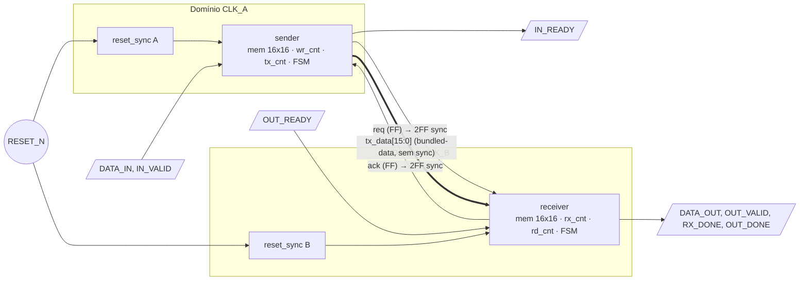
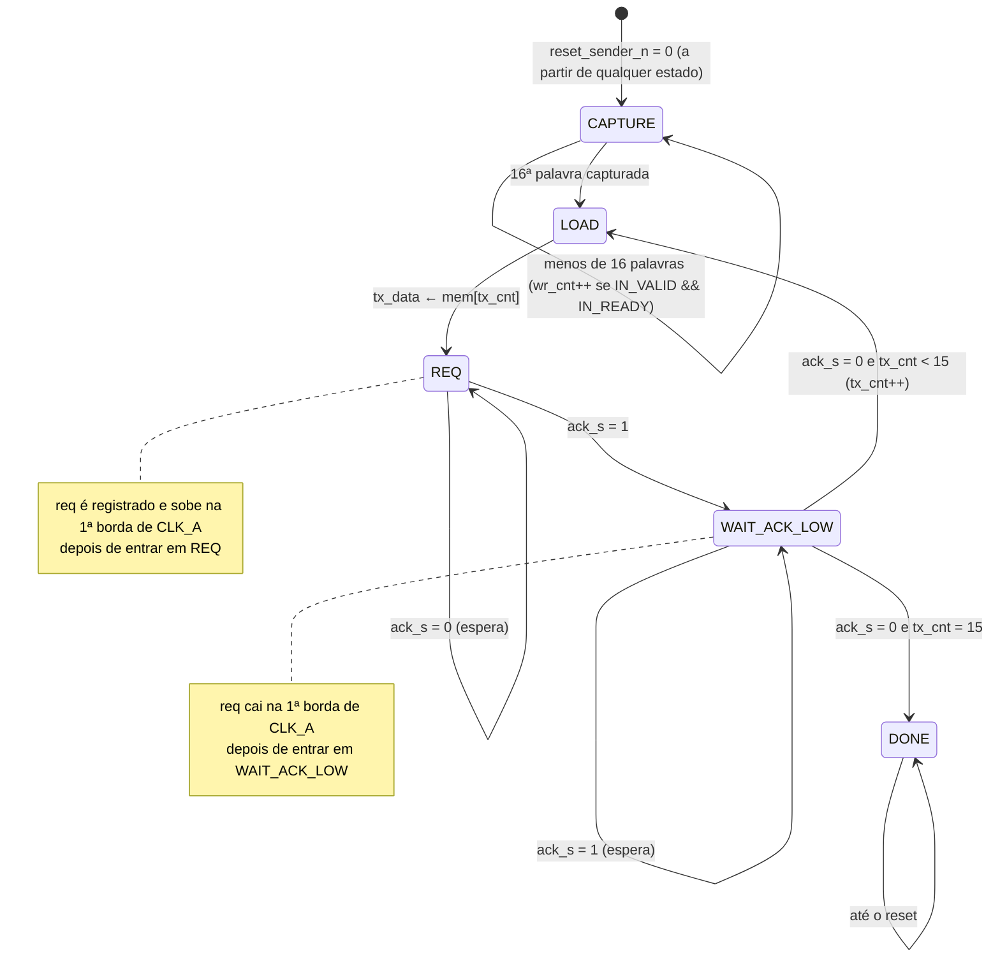
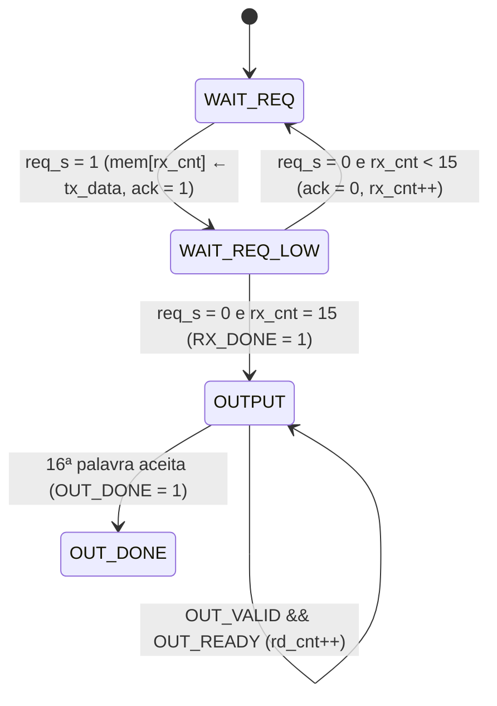

# ENGG56 2026.2 — Sistema de Comunicação com Handshake Assíncrono

Projeto de um circuito integrado digital (UFBA, Prof. Wagner L. A. de Oliveira) que:

1. captura **16 palavras de 16 bits** por uma interface valid/ready no domínio **CLK_A**;
2. transfere o bloco para o domínio **CLK_B** com handshake **REQ/ACK de 4 fases** (bundled-data);
3. após receber tudo (**RX_DONE**), entrega as palavras por uma interface valid/ready de saída.

**Entrega:** 12/12/2026 23:59 — pasta do Google Drive compartilhada com o professor.

---

## Estrutura do repositório

A organização segue o projeto `ENGG56/Exemplo/` da máquina virtual:

```
.
├── SystemVerilog/
│   ├── cdc_sync.sv           sincronizador de 2 flip-flops (REQ e ACK)
│   ├── reset_sync.sv         reset: assertion assíncrona, deassertion síncrona
│   ├── sender.sv             bloco Sender (CLK_A)
│   ├── receiver.sv           bloco Receiver (CLK_B)
│   ├── handshake_top.sv      módulo de topo
│   └── tb_handshake_top.sv   testbench (6 cenários + verificações automáticas)
├── Simulacao/                saídas da simulação (.vcd, sim.log)
├── SinteseLogica/            saídas do Yosys
├── SinteseFisica/            saídas do OpenROAD (results/, reports/, logs/)
├── scripts/
│   ├── ondas.gtkw            sinais do GTKWave já organizados
│   └── compare_platforms.py  tabela comparativa Nangate45 x Sky130HD
├── docs/
│   ├── relatorio.md          esqueleto do relatório técnico
│   └── img/                  prints de ondas e layouts
├── config.mk                 configuração do ORFS (duas plataformas)
├── handshake.sdc             restrições de temporização (CLK_A, CLK_B, CDC)
├── io_constraints.tcl        posição dos pinos no floorplan
├── Makefile.simulation
├── Makefile.synth
└── Makefile.physical
```

## Interface do módulo de topo (`handshake_top`)

| Sinal            | Direção | Domínio | Descrição |
|------------------|---------|---------|-----------|
| `CLK_A`          | in      | A       | clock do Sender |
| `CLK_B`          | in      | B       | clock do Receiver |
| `RESET_N`        | in      | —       | reset externo, **ativo em nível baixo** |
| `DATA_IN[15:0]`  | in      | A       | dado de entrada |
| `IN_VALID`       | in      | A       | `DATA_IN` válido |
| `IN_READY`       | out     | A       | Sender pronto para capturar |
| `RX_DONE`        | out     | B       | 16 palavras recebidas (fica em 1 até o reset) |
| `OUT_READY`      | in      | B       | circuito externo pronto para receber |
| `DATA_OUT[15:0]` | out     | B       | dado de saída |
| `OUT_VALID`      | out     | B       | `DATA_OUT` válido |
| `OUT_DONE`       | out     | B       | 16ª palavra aceita na saída |

## Arquitetura



### Sinais internos

| Sinal | Origem → destino | Domínio | Largura | Observação |
|---|---|---|---|---|
| `reset_sender_n` | `u_rst_sync_a` → todos os FFs do Sender | A | 1 | `reset_sender` do enunciado; ativo baixo, assertion assíncrona e deassertion síncrona |
| `reset_receiver_n` | `u_rst_sync_b` → todos os FFs do Receiver | B | 1 | `reset_receiver` do enunciado; idem |
| `req` | FF do Sender → `cdc_sync` do Receiver | A → B | 1 | sai direto de flip-flop |
| `ack` | FF do Receiver → `cdc_sync` do Sender | B → A | 1 | sai direto de flip-flop |
| `tx_data` | FFs do Sender → `mem` do Receiver | A → B | `WIDTH` | bundled-data, **sem** sincronizador; só muda com `req = ack = 0` |
| `req_s` | saída do `cdc_sync` | B | 1 | `req` sincronizado (2 FFs) |
| `ack_s` | saída do `cdc_sync` | A | 1 | `ack` sincronizado (2 FFs) |
| `wr_cnt` / `tx_cnt` | Sender | A | `$clog2(DEPTH)` | palavras capturadas / palavra em transferência |
| `rx_cnt` / `rd_cnt` | Receiver | B | `$clog2(DEPTH)` | palavra recebida / palavra entregue na saída |
| `mem` (Sender e Receiver) | — | A / B | `DEPTH × WIDTH` | flip-flops sem reset (só lidos depois de escritos) |

### Parâmetros

| Parâmetro | Valor | Onde | Observação |
|---|---|---|---|
| `WIDTH` | 16 | RTL | largura da palavra |
| `DEPTH` | 16 | RTL | palavras por bloco |
| `SYNC_STAGES` | 2 | RTL | FFs dos sincronizadores de controle e de reset; **mínimo 2** (com valores menores, `cdc_sync`/`reset_sync` param a elaboração no Yosys ou a simulação no tempo 0 no Icarus, com mensagem de erro) |
| `CLK_A_PERIOD` / `CLK_B_PERIOD` | 4,0 / 5,7 ns (Nangate45); 10,0 / 14,3 ns (Sky130HD) | `config.mk` → `handshake.sdc` | mesmos pares nos cenários T2 e T4 do testbench |

### FSM do Sender (CLK_A)



### FSM do Receiver (CLK_B)



### Decisões de projeto (resumo)

- **Bundled-data:** `tx_data` é carregado em `LOAD` e `req` só sobe no ciclo seguinte. O Receiver só captura depois que `req` passa pelos 2 flip-flops do sincronizador, então o dado está estável há pelo menos 1 ciclo de CLK_A + ~2 ciclos de CLK_B. `tx_data` só muda com `req = ack = 0`.
- **Sinais de CDC vêm direto de flip-flops** (`req`, `ack`, `tx_data`), sem lógica combinacional, para não gerar glitches.
- **Reset:** `RESET_N` ativo baixo, um `reset_sync` por domínio (`reset_sender_n`, `reset_receiver_n`).
- **Memórias em registradores** (array `mem[0:15]` de 16 bits), sem reset, para economizar área; só são lidas depois de escritas.
- **SDC:** não usamos `set_clock_groups -asynchronous`. Os caminhos A↔B continuam na análise de setup com `set_max_delay` (orçamento = menor período); só a análise de hold entre domínios e o caminho da porta `RESET_N` são excluídos. Detalhes em `handshake.sdc`.

---

## Preparar a máquina virtual

1. Instalar o **Oracle VirtualBox** e descompactar a VM.
2. No Windows, criar a pasta `C:\Compartilhada`.
3. Na VM (desligada): *Configurações → Pastas Compartilhadas → +* → caminho `C:\Compartilhada`, nome `Compartilhada`, marcar **Montar automaticamente**.
4. Ligar a VM (senha: `asic`). A pasta aparece em `/media/sf_Compartilhada`. Se der "permissão negada":
   ```bash
   sudo usermod -aG vboxsf asic    # depois reinicie a VM
   ```
5. **Copie o projeto para dentro da VM** (rodar o ORFS direto na pasta compartilhada costuma ser lento e dar problema com links simbólicos):
   ```bash
   cp -r /media/sf_Compartilhada/ENGG56-handshake ~/ENGG56/
   cd ~/ENGG56/ENGG56-handshake
   ```
6. Confira onde está o OpenROAD-flow-scripts na VM (o guia cita `OpenROAD-flow-scripts/flow/platforms`). Se não for `~/OpenROAD-flow-scripts`, passe o caminho nos comandos: `ORFS_DIR=/caminho/para/OpenROAD-flow-scripts`.
7. **Compare nossos Makefiles com os do `~/ENGG56/Exemplo/`.** Os nossos seguem os mesmos alvos do guia, mas foram escritos sem acesso aos originais; se algum caminho ou variável for diferente na VM, ajuste com base no Exemplo.

## Como rodar

Todos os comandos na raiz do projeto. Rodar um Makefile sem alvo mostra a ajuda.

| # | Comando | Etapa |
|---|---------|-------|
| 1 | `make -f Makefile.simulation run` | Simulação + GTKWave |
| 2 | `make -f Makefile.synth view_rtl MOD=sender` | RTL otimizado (genérico) |
| 3 | `make -f Makefile.synth view_mapped MOD=cdc_sync` | Mapeamento independente |
| 4 | `make -f Makefile.synth stat` | Relatório de células do Yosys → `SinteseLogica/` |
| 5 | `make -f Makefile.physical synth` | Síntese do ORFS |
| 6 | `make -f Makefile.synth view_orfs` | Netlist usada no fluxo físico |
| 7 | `make -f Makefile.physical floorplan` / `place` / `cts` / `grt` / `route` / `finish` | Fluxo físico |
| 8 | `make -f Makefile.physical gui` | Layout no OpenROAD GUI |
| 9 | `make -f Makefile.physical reports` | Área, utilização, WNS/TNS |

**Segunda plataforma (Sky130HD):** acrescente `PLATFORM=sky130hd` a qualquer comando de síntese ou físico, ou rode as duas de uma vez:

```bash
make -f Makefile.physical both       # finish em nangate45 e sky130hd
make -f Makefile.physical compare    # gera docs/comparacao_plataformas.md
```

Layout final: `SinteseFisica/results/<plataforma>/handshake/base/6_final.gds`.

Os períodos de clock de cada plataforma ficam em `config.mk` (`CLK_A_PERIOD`, `CLK_B_PERIOD`). Se o WNS sair negativo, aumente os períodos; se sobrar muito slack, dá para apertar e discutir isso no relatório.

## Testbench

`make -f Makefile.simulation sim` termina com `TODOS OS TESTES PASSARAM` ou com a lista de erros.

| Cenário | O que testa |
|---------|-------------|
| T1 | valores durante o reset; liberação de `reset_sender_n`/`reset_receiver_n` na borda do próprio clock |
| T2 | fluxo sem esperas (CLK_A = 4,0 ns, CLK_B = 5,7 ns — par do SDC Nangate45); `IN_VALID` mantido depois da 16ª palavra é ignorado |
| T3 | `RESET_N` ativado no meio do 5º handshake, fora das bordas de clock |
| T4 | `IN_VALID` e `OUT_READY` inativos aleatoriamente (esperas nas duas interfaces); CLK_A = 10,0 ns, CLK_B = 14,3 ns (par do SDC Sky130HD) |
| T5 | clocks invertidos (CLK_A = 23,3 ns lento, CLK_B = 7,0 ns rápido) |
| T6 | clocks quase iguais (CLK_A = 10,0 ns, CLK_B = 10,1 ns): a fase relativa escorrega 0,1 ns por ciclo e passa por bordas praticamente coincidentes |

Monitores sempre ativos checam: ordem/conteúdo das palavras, estabilidade de `DATA_OUT`/`OUT_VALID` com `OUT_READY = 0`, `OUT_VALID` só após `RX_DONE`, `RX_DONE` permanente, `OUT_DONE` só após a 16ª palavra, ordem das 4 fases REQ/ACK e estabilidade de `tx_data` durante o handshake.

## Entregáveis (checklist)

- [ ] Código SystemVerilog (`SystemVerilog/`)
- [ ] Testbench e arquivos de simulação
- [ ] Formas de onda / prints dos cenários (`docs/img/`)
- [ ] Scripts e Makefiles de síntese lógica e física
- [ ] Relatórios do Yosys (`SinteseLogica/`) e do OpenROAD (`SinteseFisica/reports/`)
- [ ] Layout final (`6_final.gds` + prints do GUI) nas duas plataformas
- [ ] Relatório técnico com tabela comparativa (`docs/relatorio.md`)
