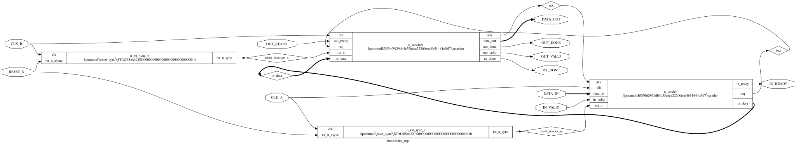

# Verificação do topo — `view_rtl` (Yosys)

Tarefa: **Módulo topo + integração dos blocos** · conferida em 27/11/2026
Base: `main` em `7cb4147` (merge do PR #5)

## Como reproduzir

```bash
make -f Makefile.synth view_rtl                # topo (handshake_top)
make -f Makefile.synth view_rtl MOD=cdc_sync   # submódulos menores
make -f Makefile.synth view_rtl MOD=reset_sync
```

O alvo roda `read_verilog -sv <RTL>; hierarchy -check -top handshake_top; proc; opt; show $(MOD)`.

## Resultado

- **Sem erros e sem warnings.** O `hierarchy -check` passou.
- Esquemático do topo: [`img/handshake_top_rtl.svg`](img/handshake_top_rtl.svg)



### Hierarquia

| Instância | Módulo | Domínio |
|---|---|---|
| `u_rst_sync_a` | `reset_sync` (STAGES = 2) | CLK_A |
| `u_rst_sync_b` | `reset_sync` (STAGES = 2) | CLK_B |
| `u_sender` | `sender` (contém 1 `cdc_sync` para o `ack`) | CLK_A |
| `u_receiver` | `receiver` (contém 1 `cdc_sync` para o `req`) | CLK_B |

O topo tem 11 portas e 4 submódulos. Os parâmetros `WIDTH`, `DEPTH` e `SYNC_STAGES` chegam aos submódulos (o Yosys gera as versões `$paramod`).

### Ligações conferidas

**Domínio A (CLK_A)**
- `CLK_A` → `clk` de `u_rst_sync_a` e de `u_sender`
- `RESET_N` → `u_rst_sync_a.rst_n_async` → `reset_sender_n` → `u_sender.rst_n`
- `DATA_IN` → `u_sender.data_in` (barramento); `IN_VALID` → `u_sender.in_valid`
- `u_sender.in_ready` → `IN_READY`

**Domínio B (CLK_B)**
- `CLK_B` → `clk` de `u_rst_sync_b` e de `u_receiver`
- `RESET_N` → `u_rst_sync_b.rst_n_async` → `reset_receiver_n` → `u_receiver.rst_n`
- `OUT_READY` → `u_receiver.out_ready`
- `u_receiver` → `DATA_OUT`, `OUT_DONE`, `OUT_VALID`, `RX_DONE`

**Canal entre domínios**
- `u_sender.req` → `req` → `u_receiver.req`
- `u_receiver.ack` → `ack` → `u_sender.ack`
- `u_sender.tx_data` → `tx_data` → `u_receiver.rx_data` (barramento, **sem sincronizador**: bundled-data)

### Conclusões

- **Reset:** um único `RESET_N` assíncrono, sincronizado separadamente em cada domínio, cada `reset_sync` com o clock do próprio domínio. Nenhum reset cruza de domínio.
- **CDC:** só `req`, `ack` e `tx_data` atravessam os domínios. `req` e `ack` passam por `cdc_sync` (dentro do receiver e do sender); `tx_data` fica estável enquanto o `req` é sincronizado, conforme o protocolo bundled-data.
- Nenhuma porta solta e nenhum fio sem destino.
